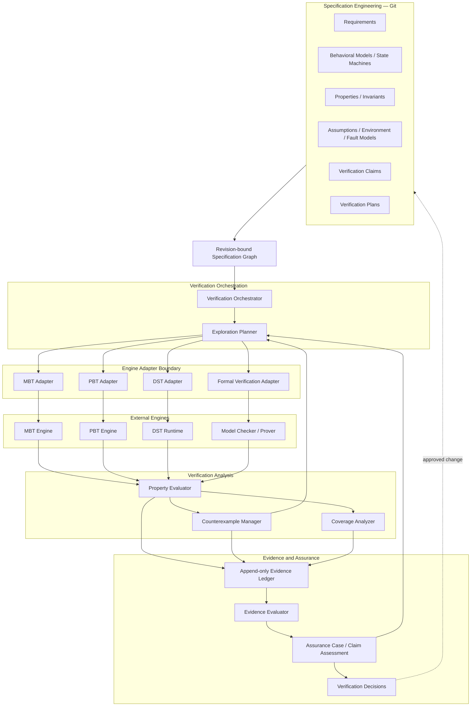

# Architecture — Specification-Driven Verification

## 1. Architectural position

The extension is a verification capability within SpecForge, not a separate test framework. It extends the existing Specification Graph and project lifecycle.

**Authoritative source:** Git-controlled SpecForge project artifacts.  
**Canonical integration model:** existing typed Specification Graph.  
**Execution:** external specialized engines behind adapters.  
**Historical record:** append-only Evidence Ledger.  
**Interpretation:** Evidence Evaluator and Assurance Assessor.

## 2. Logical architecture

## 3. Component responsibilities

### Specification Graph integration
- Resolves and validates typed verification artifacts.
- Produces immutable graph snapshots.
- Exposes dependency relationships and source revision metadata.
- Does not own external engine execution.

### Verification Orchestrator
- Accepts a VerificationPlan.
- Resolves graph snapshot and dependencies.
- Dispatches activities to compatible adapters.
- Tracks run lifecycle and collects results.
- Does not reinterpret a tool result beyond the adapter's declared mapping.

### Exploration Planner
- Selects or recommends work based on plan policy, coverage gaps, stale evidence, assumptions, and prior counterexamples.
- Explains why each activity is recommended.
- Does not modify authoritative specifications.

### Engine adapters
Each adapter translates between SpecForge's canonical concepts and an engine-specific API/schema. Adapters validate input and output, retain tool versions, and report unsupported capabilities.

### Property Evaluator
- Evaluates trace-checkable properties against execution traces or model traces.
- Emits explicit result categories.
- Records evaluator version and property revision.

### Counterexample Manager
- Stores original and minimized counterexamples.
- Supports replay where the engine allows it.
- Preserves causal constraints and minimization provenance.
- Links diagnosis and remediation decisions.

### Evidence Ledger
- Appends immutable evidence metadata and artifact references.
- Maintains provenance and relationships.
- Retains failed, inconclusive, and contradictory results.
- Supports export and integrity verification.

### Evidence Evaluator / Assurance Assessor
- Evaluates evidence relevance, scope, freshness, validity, provenance, independence, and contradictions.
- Produces a qualified assessment.
- Does not rewrite historical records or conflate method strengths.

## 4. Adapter contract (conceptual)

An adapter should expose the equivalent of:

- `capabilities()` — supported artifact kinds, methods, replay, shrinking, coverage, trace formats.
- `validate(plan, graph_snapshot)` — compatibility and precondition checks.
- `prepare(plan, graph_snapshot)` — produce an engine-specific execution request.
- `execute(request)` — run or submit work.
- `status(run_id)` — report lifecycle and progress.
- `collect(run_id)` — return normalized results plus raw artifact references.
- `replay(counterexample_descriptor)` — optional capability.
- `minimize(counterexample)` — optional capability.

The exact API must follow existing SpecForge extension conventions. These names are illustrative, not a demand for a particular programming language or RPC protocol.

## 5. Common result envelope

Every adapter result should normalize to:

- run ID and activity ID
- adapter ID and version
- external engine name and version
- graph snapshot ID and source revision set
- property and claim IDs
- method and declared scope/bounds
- assumptions
- start/end timestamps and terminal status
- normalized result category
- raw result/artifact references and content digests
- replay descriptor, if available
- diagnostics and limitations

The adapter MUST preserve the original engine-specific status and payload reference alongside the normalized category.

## 6. Deployment and persistence

The implementation must first reuse existing SpecForge storage, Git, and artifact conventions. Large traces may be stored as content-addressed blobs with metadata and digests in the ledger. Do not introduce a new database or service until repository reconnaissance demonstrates a need.

## 7. Security and trust boundaries

- External tool output is untrusted and must be schema-validated.
- Adapter execution must use the existing project execution isolation and permission model.
- Evidence content must be integrity-checkable.
- Credentials and secrets must not be copied into evidence payloads.
- Imported traces may contain sensitive application data; retention and redaction must follow project policy.
- AI-generated diagnoses are recommendations, not authoritative decisions.
