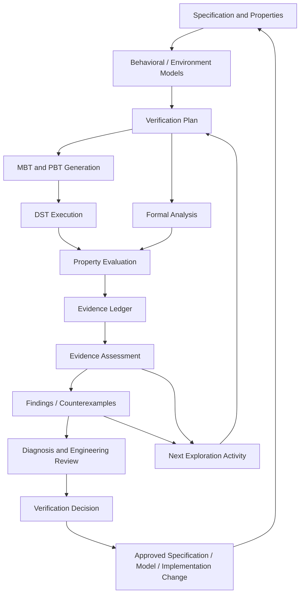

# Verification, Counterexamples, Evidence, and Assurance

## 1. The exploration dimensions

The integrated platform explores distinct dimensions:

| Dimension | Discipline | Typical variation |
|---|---|---|
| Input space | PBT | values, payloads, sizes, generated data |
| Behavioral space | MBT | state transitions, action sequences, protocol paths |
| Execution space | DST | scheduling, virtual time, message delivery, faults |
| Abstract state space | Formal methods | all modeled states/transitions within declared semantics and bounds |

These dimensions interact but must not be collapsed into one coverage number. The planner may combine them strategically rather than enumerate their Cartesian product.

## 2. Feedback loop

A result can feed different destinations:
- Implementation defect → implementation remediation and regression replay.
- Specification defect → proposed requirement revision.
- Behavioral-model defect → model correction.
- Environment/assumption defect → revise or validate assumptions.
- Verification defect → correct property/evaluator/adapter.
- Coverage gap → generate targeted verification activity.

No diagnosis should silently mutate authoritative artifacts.

## 3. Counterexample lifecycle

1. **Detect:** property evaluator or formal engine reports a violation.
2. **Capture:** preserve original trace/model witness, inputs, schedule, faults, virtual time, source revisions, tool versions, and property revision where available.
3. **Validate:** confirm that the witness is valid for the declared model/run and that the property checker reproduces the violation.
4. **Minimize:** optionally shrink input, scenario, schedule, and environment independently while preserving causal/model constraints.
5. **Replay:** rerun using the recorded replay descriptor where supported.
6. **Classify:** assign a provisional diagnosis; unresolved is a valid classification.
7. **Decide:** record an accountable VerificationDecision.
8. **Remediate:** apply approved change and preserve traceability.
9. **Regress:** replay the original/minimized counterexample and run targeted verification again.

## 4. Counterexample structure

A counterexample should capture, where available:

- stable counterexample ID
- violated property ID and revision
- finding ID
- originating run and engine
- graph snapshot and source revision set
- initial state
- ordered events/transitions
- generated input values or references
- actor/process identities
- scheduler decisions
- virtual clock values and advances
- injected faults and environmental conditions
- violation location and observed/expected values
- replay descriptor and determinism guarantees
- original artifact digest
- minimization lineage and minimizer version
- diagnosis and decision references

The system must not claim replayability if the necessary controls or artifacts were not provided by the engine.

## 5. Counterexample minimization

Support separate strategies:

- Input shrinking: reduce generated data.
- Scenario shrinking: remove irrelevant actions/steps.
- Schedule shrinking: reduce or simplify scheduling decisions.
- Environment shrinking: remove unnecessary faults or environmental events.

A minimized counterexample is valid only if it still reproduces the same relevant violation under compatible semantics. Preserve the original counterexample. Record the minimization algorithm, version, attempts, and result.

## 6. Evidence Ledger

An EvidenceRecord is an immutable fact record. It should contain:

- evidence ID and type
- producer and producer version
- source revision set and graph snapshot
- run/activity/plan references
- property and claim references
- scope and assumptions
- timestamps and terminal status
- result category
- content digest and artifact references
- provenance/dependency links
- limitations and validation status

Evidence relationships include `supports`, `contradicts`, `corroborates`, `derived_from`, `supersedes`, and `invalidates`.

A corrected result is a new record. Never edit the original record to make history appear as if the correction had always existed.

## 7. Evidence assessment

Assess evidence across separate dimensions:

- Validity: was the evidence correctly produced and schema-validated?
- Provenance: can its origin and dependencies be established?
- Relevance: does it address this claim/property?
- Scope compatibility: does its model/configuration cover the claim's scope?
- Freshness: are the dependencies still current?
- Independence: are results genuinely independent or correlated?
- Method strength: what does this method establish, and what does it not establish?
- Contradictions: is there evidence that refutes or weakens the claim?
- Completeness: are required evidence types or assumptions missing?

The assessment must explain its rationale. It must not reduce heterogeneous evidence to an opaque score.

## 8. Probabilistic assessment policy

Probabilistic estimates are optional and deferred until a defensible statistical model is available.

A numerical estimate is permitted only when the system records:
- hypothesis/quantity being estimated
- sampling population and scope
- sampling/generation process
- dependence/correlation assumptions
- prior/model assumptions, if Bayesian
- estimator or inference method and version
- sample size and observed outcomes
- uncertainty interval or posterior distribution, as appropriate
- known limitations and applicability

Do not calculate confidence as `passed_tests / total_tests` and call it the probability of correctness. Do not turn a proof into a probability. Keep formal result, deterministic execution fact, and statistical estimate as distinct evidence types.

## 9. Assurance case

Use a claim–argument–evidence structure:

- Claim: proposition under evaluation.
- Subclaim: decomposed proposition, if needed.
- Argument: rationale connecting evidence to claim.
- Evidence: immutable records.
- Assumption: condition under which the argument applies.
- Context/scope: system, version, configuration, and operational bounds.
- Defeater/limitation: known reason the argument may not hold.

A claim can be `supported`, `refuted`, `inconclusive`, `stale`, or `requires_review`. A supported claim is always qualified by scope and evidence method. Only a suitable formal proof can justify a formal `proved` result, and only for the proposition and assumptions actually proved.

## 10. Evidence freshness

Evidence dependencies include:
- requirement and property revisions
- behavioral/environment/fault model revisions
- implementation revision
- graph snapshot
- engine and adapter versions
- configuration and execution topology
- assumptions and bounds

On change, compute an impact set. Mark evidence as stale or requiring reassessment; preserve it historically. Do not automatically delete or rewrite it. A change to an unrelated artifact should not invalidate evidence merely because it shares a project.
